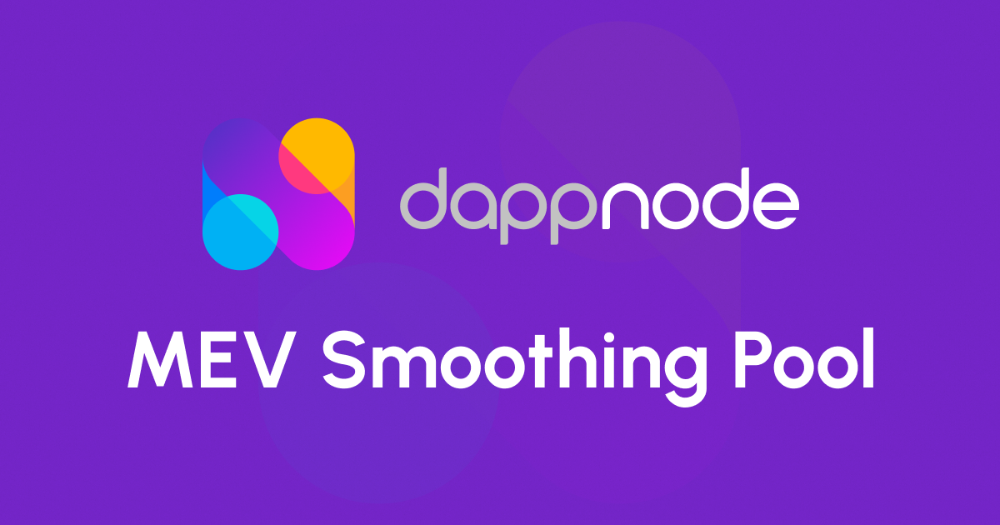

## Getting Started

```bash
pnpm install
```

Use Node.js 24.22.1 or newer in the Node.js 24 release line and the pnpm version
specified in `package.json`. Configure the public chain, contract and wallet
project variables and `BACKEND_URL` in `.env.local` (see `.env_testnet` for the
Hoodi configuration). The SIWE API also requires `IRON_SESSION_PASSWORD`, a
private, randomly generated password of at least 32 characters.

```bash
pnpm dev
```

Before pushing and deploying run:

```bash
pnpm typecheck
pnpm lint
pnpm test
pnpm run build
pnpm build-storybook
```

Open [http://localhost:3000](http://localhost:3000) with your browser to see the result.

## Deploy on Vercel

The easiest way to deploy your Next.js app is to use the [Vercel Platform](https://vercel.com/new?utm_medium=default-template&filter=next.js&utm_source=create-next-app&utm_campaign=create-next-app-readme) from the creators of Next.js.

Check out our [Next.js deployment documentation](https://nextjs.org/docs/deployment) for more details.

## Legal Disclaimer

[Terms Of Service](https://github.com/dappnode/mev-sp-fe/blob/main/TERMS_OF_SERVICE.md)
